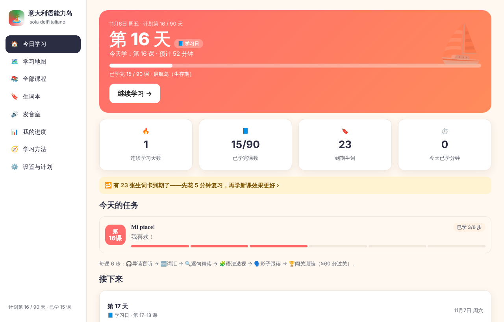
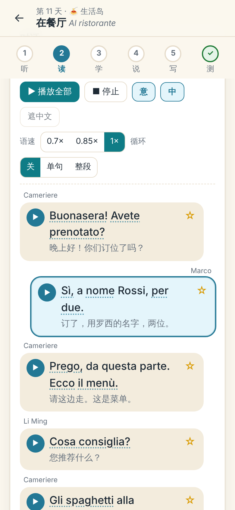
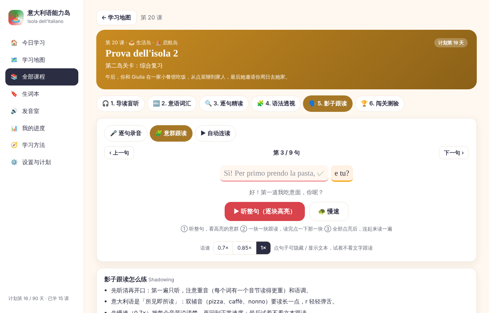
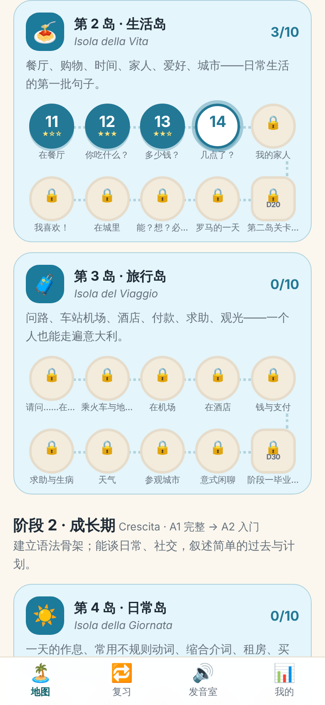
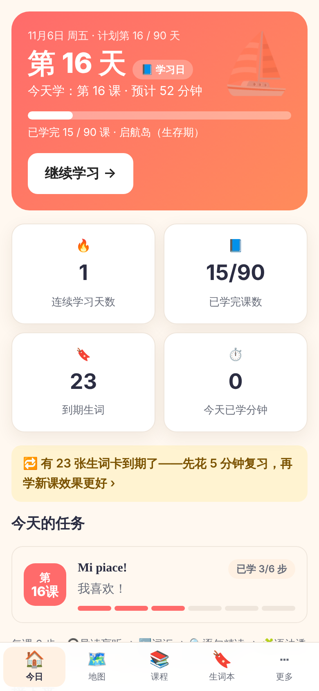
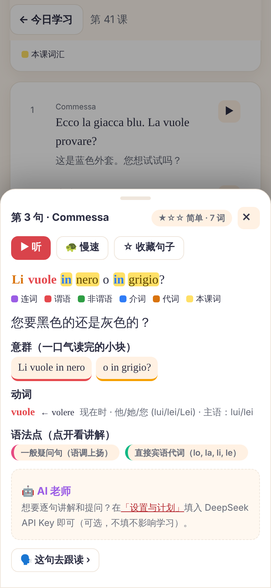
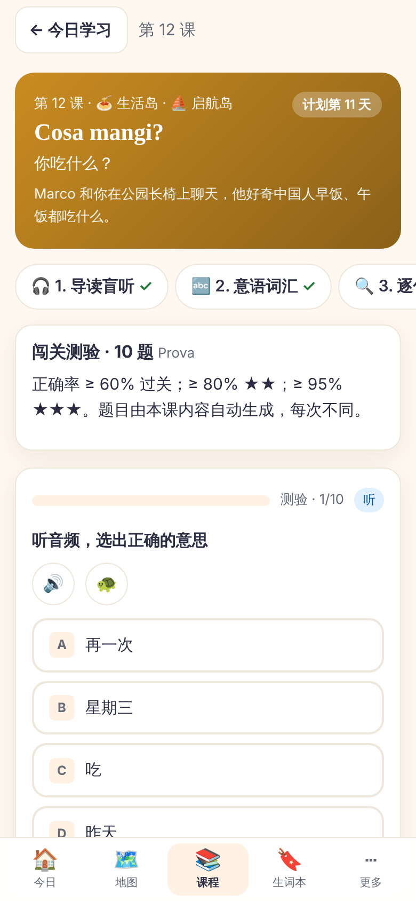
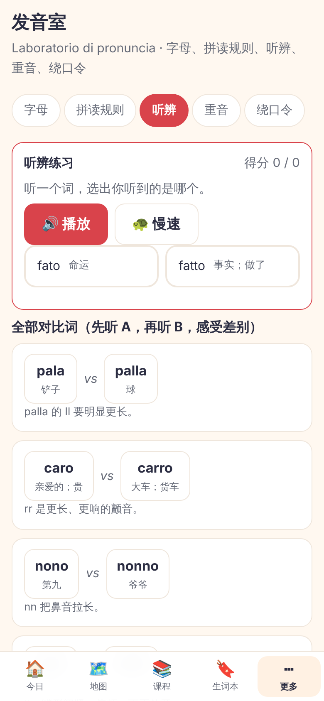

# 🏝️ 意大利语能力岛 · Isola

**从零开始，90 天，听说读写同步推进的意大利语学习程序——按「新概念英语能力岛」的程序流程做成。**

一个在浏览器里运行的闯关式学习程序：**全程意大利语发音 · 彩色句子分析 · 每课 6 步学习法 · 学习计划可调（默认 90 天，也能改成 30 / 60 / 120 天）**。
前 30 天打通发音，并掌握日常与差旅口语（咖啡吧、餐厅、问路、车站、机场、酒店、药店……）。

> 流程对齐的是 [gusujushi/nce-english-island](https://github.com/gusujushi/nce-english-island)（新概念英语能力岛 1–4 册）。哪些做了对应、哪些没有移植、为什么——见 [docs/REFERENCE_ALIGNMENT.md](docs/REFERENCE_ALIGNMENT.md)。

<p>
  
  
</p>
<p>
  
  
</p>
<p>
  
  
  
  
</p>

## 它是怎么学的

**每天打开「今日学习」→ 按 6 步学完当天的课 → 每 5 天做一次复习通关。**

| 步骤 | 做什么 |
| --- | --- |
| 🎧 ① 导读盲听 | 看场景和目标，带着听前问题盲听整段对话（可慢速），再做理解题 |
| 🔤 ② 意语词汇 | 词卡：拼写、**大写标出重读音节**、中文、课文里的例句（高亮该词）；遮住中文自测；☆ 加入生词本 |
| 🔍 ③ 逐句精读 | 点一句听发音，看它的**彩色句子分析**：谓语红、连词紫、非谓语绿、介词蓝、代词橙、本课词汇黄底；意群切分、主干提示、动词原形与变位说明、语法点；点任意一个词看释义；带短文的课有阅读理解题 |
| 🧩 ④ 语法透视 | 本课语法讲解 + 从本课句子里自动扫描出的语法点（附课文例句）+ 动词一览表 + 发音小练习 + 文化提示 + 微写作 + 小测 |
| 🗣️ ⑤ 影子跟读 | 🎤 逐句录音对比 / 🧩 意群高亮跟读 / ▶ 自动连读（放一句、留出同样长的空档让你说）/ 🎭 角色扮演；另有每课 3–5 个「看中文，开口说」场景任务 |
| 🏆 ⑥ 闯关测验 | 10 题（岛屿关卡 20 题、阶段毕业考 30 题），由本课内容自动生成，≥ 60 分过关，记录最好成绩 |

- **学习计划可调**：预设 30 / 60 / 90 / 120 天，或自定义 5–365 天；可改起始日期、只学其中几座大岛。**每 5 天一轮：4 天学新课 + 1 天复习通关**；课太轻会合并到一天，计划比课多时多出来的是自由日。没有锁，落后了不丢进度，首页会提醒。默认 90 天计划里，第 1–30 课正好在前 30 天。
- **三座大岛 × 九个小岛**：⛵ 启航岛·生存期（第 1–30 课，发音岛 / 生活岛 / 旅行岛）→ 🌱 成长岛·成长期（第 31–60 课）→ 🧭 探索岛·进阶期（第 61–90 课）。完整大纲见 [docs/COURSE_DESIGN.md](docs/COURSE_DESIGN.md)。
- **生词本**：莱特纳盒子间隔复习（6 个盒子，1 / 2 / 4 / 8 / 16 / 32 天），☆ 收藏词和句子，学完一课自动入库；到期复习、错题重练、收藏复习、随机巩固。
- **发音室**：字母与读音规则、最小对立词听辨（pala / palla）、重音、绕口令。
- **我的进度**：等级、五项能力雷达（听说读写 + 知识）、90 课闯关成绩、学习热力图、徽章。
- **AI 老师（可选）**：填入你自己的 DeepSeek API Key，精读页的每一句都可以让 AI 逐句讲解、提问。Key 只存在本机，导出进度时不带；不填不影响任何功能。
- **纯静态、可离线、可安装**：双击 `index.html` 就能用；发布到 GitHub Pages 后可「安装」成 App，断网也能学。进度保存在浏览器本地，可导出 / 导入。

## 内容规模

| 项目 | 数量 |
| --- | --- |
| 课程 | 90 课（含 9 个岛屿关卡、3 次阶段毕业考），分 3 座大岛、9 个小岛 |
| 对话 | 666 句（约 4,800 词） |
| 阅读短文 | 53 篇（268 句），含 124 道阅读理解题 |
| 精读句子 | 934 句（对话 + 短文），每句都有彩色分析 |
| 词汇 / 词块 | 1,310 条（跨课重复的合并后得到 1,262 张词汇卡；另有 179 张关键句卡，共 1,441 张自动入库的卡片） |
| 语法讲解 | 227 块（242 个带音频的例句）；另有 44 个可自动识别的语法点 |
| 听力理解题 / 知识小测 | 270 道 / 368 道（另有每次自动生成的测验） |
| 意大利语音频 | 3,324 条（Piper 合成，共约 32 MB，离线可用） |
| 动词形态库 | 约 490 个动词原形、2.1 万个变位形式（规则变位 + 不规则 + 派生 + 接代词） |

## 快速开始

```bash
# 方式 1：直接双击 index.html（录音功能需要 localhost 或 https）
# 方式 2：起一个静态服务器
python3 -m http.server 8080        # 然后打开 http://localhost:8080
```

**部署到 GitHub Pages**：仓库 Settings → Pages → Source 选 *Deploy from a branch*，分支选 `main`（或当前分支），文件夹选 `/ (root)`，无需构建（仓库里有 `.nojekyll`）。部署后用手机浏览器打开网址，iPhone 用 Safari「添加到主屏幕」，安卓用 Chrome「安装应用」。

## 手机上使用（像 App 一样）

程序是纯静态的网页（PWA）：把它发布成一个 **https 网址**，手机打开后「添加到主屏幕」，就有桌面图标、全屏打开，断网也能学（做法和新概念英语能力岛相同）。

**第一步：发布成网址（只需做一次）——用 GitHub Pages**

1. 打开仓库 **Settings → Pages**。
2. **Source** 选 *Deploy from a branch*；**Branch** 选包含这些文件的分支（现在是 `claude/italian-isola-course`；合并到 `main` 之后选 `main`），文件夹选 **`/ (root)`**，点 Save。（仓库里已有 `.nojekyll`，不需要构建。）
3. 等 1–2 分钟，页面顶部会出现网址：`https://gusujushi.github.io/italy-learning/`

> **私有仓库的限制**：GitHub Pages 对私有仓库需要付费的 GitHub Pro / Team 套餐；免费账号要把仓库改成 Public（Settings → General 最下面 Danger Zone → Change visibility）。公开后任何人都能看到课程内容和音频，而且**仓库还没有选许可证**，默认保留所有权利——是否公开请自己决定。另外，用私有仓库发布出来的 Pages 网址同样是公开可访问的。
>
> **不想公开 / 不想付费**：把同一个仓库连到 Cloudflare Pages、Netlify 或 Vercel（它们的免费套餐支持私有仓库）：构建命令留空，输出目录填 `/`（根目录），得到一个 https 网址，后面的步骤完全一样。
>
> 在中国大陆访问 `github.io` 有时不稳定；打不开时换个网络，或改用上面的 Cloudflare Pages / Netlify。

**第二步：在手机上添加到主屏幕**

- **iPhone**：必须用 **Safari** 打开网址 → 点底部「分享」按钮 ⬆️ → 选「添加到主屏幕」→ 添加。
- **安卓**：用 **Chrome** 打开网址 → 点页面里的「安装」按钮，或菜单 ⋮ →「安装应用 / 添加到主屏幕」。
- 程序在手机浏览器里会自动在「今日学习」顶部提示添加步骤；也可以在「设置与计划 → 安装到手机 / 离线使用」里查看。

**第三步：离线用的音频（可选）**

「设置与计划 → 安装到手机 / 离线使用 → 下载全部音频到本机」（约 33 MB，建议连 Wi-Fi）。不下载也能用——音频会在第一次播放时从网上取。

注意：

- **录音**需要 https（GitHub Pages 是 https），第一次点 🎤 时浏览器会请求麦克风权限。
- **iPhone 上，主屏幕里的应用和 Safari 的学习进度是分开保存的**：先添加到主屏幕再开始学；已经在 Safari 里学过的，用「设置与计划 → 导出 / 导入进度」搬过去。
- 想先在电脑上看：`python3 -m http.server 8080` 后打开 `http://localhost:8080`；同一个 Wi-Fi 下，手机也能用 `http://电脑的局域网地址:8080` 访问，但这是 http，**不能安装、不能录音**。

## 声音从哪来

1. **优先播放 `audio/` 里的预生成 MP3**（Piper `it_IT-paola-medium`，训练数据 CC0；48 kbps 单声道，响度已统一，峰值留有余量不削波）。
2. 没有对应文件时，回退到**浏览器自带的意大利语语音**（Web Speech API）。部分国产安卓设备没有意大利语语音，所以仓库自带了音频。
3. **录音**用 MediaRecorder（需要 localhost / https / 本地文件）；**语音识别**依赖浏览器联网服务，国内常不可用，程序会自动退回"录音对比 + 自评"。录音只留在内存里，不上传、不落盘。

> **合成语音不等于真人发音。** 重音和语调仍建议多听真人材料校正；大舌音 r 的颤动也不如真人明显。程序里**没有发音打分**——录音只用于"和原音对比 + 自评"。

重新生成音频（修改课程文本之后）：

```bash
pip install piper-tts onnx                 # 并下载 it_IT-paola-medium.onnx（见 tools/gen_audio.py 开头）
node tools/export_course.js build/course.json
python3 tools/gen_audio.py --model /path/to/it_IT-paola-medium.onnx   # 可断点续跑，只生成新增文本
python3 tools/refine_pairs.py --model /path/to/it_IT-paola-medium.onnx  # 发音室对比词：逐条验证并择优重录
```

`refine_pairs.py` 的作用：合成语音每次都有随机性，pala / palla 这类"单辅音 vs 双辅音"的词对，个别词对单次采样时对比可能偏弱。脚本读取模型给每个音素分配的时长，为每个词对挑出双辅音约为单辅音 2–3 倍长的那一次录音。生成时还做了几处针对性修正（见 `tools/tts_text.py`）：把 espeak 读成闭口 e 的句中 `è`、`c'è`、`quant'è` 改回开口的 ɛ；把词首的闪音 r（Roma、ristorante）换成颤音写法；所有音频按有声段响度统一。

## 开发与质检

```bash
npm test                          # 单元测试 88 项：计划引擎、形态库、彩色分析、Store、PWA 外壳、数据解析、练习生成、音频完整性……
node tools/validate.js            # 课程数据结构校验（天数、格式、答案序号、表格列数…）
node tests/e2e/flow.js            # 端到端：走完第 1 课的 6 步，再测复习日、生词本、计划日历、AI（假接口）、音频播放、PWA 离线、手机布局
node tests/e2e/all-days.js        # 90 课 × 6 步 = 540 个页面逐页渲染，精读页逐句点开彩色分析，确认没有 JS 错误
node tests/e2e/pwa-subpath.js     # 模拟 GitHub Pages 子路径：Service Worker、下载全部音频、断网后页面与音频仍可用
node tests/e2e/screenshots.js     # 重新生成 docs/screenshots/
# 意大利语拼写检查（Hunspell 词典 + 词频表，见 tools/qa_italian.py 开头）
python3 tools/qa_italian.py --dict /path/to/it_IT/it_IT --freq /path/to/it_50k.txt
# 音频抽查：用 Whisper 把整句"听写"回来，与原文比对（pip install faster-whisper）
python3 tools/qa_audio_asr.py --model small --sample 150 --min-words 3
python3 tools/make_icons.py       # 重新生成 PWA 图标（需要 Pillow）
```

端到端测试需要 `playwright`（`npm i -D playwright && npx playwright install chromium`）。

## 目录

```
index.html            页面入口（侧栏 / 底栏 + 视图容器）
manifest.webmanifest  PWA 清单            sw.js   Service Worker（外壳预缓存；音频缓存可选）
css/app.css           样式（明 / 暗主题，手机优先）
js/                   纯函数模块（Node 与浏览器通用）：
                        italian.js 文本比对 · course.js 课程解析 · srs.js 间隔复习 · exgen.js 练习生成
                        plan.js 学习计划引擎 · morph.js 意大利语动词形态库 · grammar.js 彩色分析与语法点
                        lesson.js 课的辅助函数（课文行、例句、分量、导读、卡片编号）
                      界面：app.js 路由 · store.js 进度 · sound.js 声音 · ai.js AI 老师 · ui.js · widgets.js
                        view-home.js 今日 / 地图 / 课程 · view-lesson.js 课程页 · lesson-read.js 精读 · lesson-shadow.js 跟读
                        view-words.js 生词本 · view-review.js 复习日 · view-lab.js 发音室 · view-me.js · view-settings.js
data/                 课程内容：meta.js（阶段 / 岛屿）、island1–9.js（每岛 10 课）、pron.js（发音室）
audio/                预生成的意大利语音频 + manifest.js          icons/  PWA 图标
docs/                 REFERENCE_ALIGNMENT（与参考项目的对齐）· COURSE_DESIGN（课程设计）· DATA_FORMAT · REFERENCES
tools/                校验、导出、拼写质检、音频生成与质检、图标生成
tests/                单元测试与端到端测试
```

## 预期水平与局限（实话实说）

按每天约 50–60 分钟、认真完成每一步计：第 30 天能按拼读规则读出任何意大利语单词，并在咖啡吧、餐厅、车站、酒店完成基本对话；第 60 天 A1 完整；**第 90 天约为 A2，含少量 B1 入门内容**（条件式、虚拟式入门）。这**不等于**能流利交谈——之后需要大量真实输入和真人对话。第 90 天给出了后续路线（CELI / CILS / PLIDA、可用资源与 30 天计划）。

- **内容未经意大利语母语者审校**：课文、对话、讲解、题目由 AI 辅助原创，做过自动校验（结构、拼写词典、重音核对、语音回听抽查），但没有母语者或专业教师逐句审校。
- **彩色分析是规则标注**：覆盖全部 934 个课文句子，也有单元测试固定典型情况，但个别句子可能标错；拿不准时以课文讲解和词典为准。
- **语音是合成的**，见上文；AI 老师也可能出错。

## 许可与致谢

课程内容为原创；参考项目与第三方资源的许可、用途见 [CREDITS.md](CREDITS.md) 和 [docs/REFERENCES.md](docs/REFERENCES.md)。**仓库所有者尚未选择许可证**（添加 `LICENSE` 之前默认保留所有权利）。
