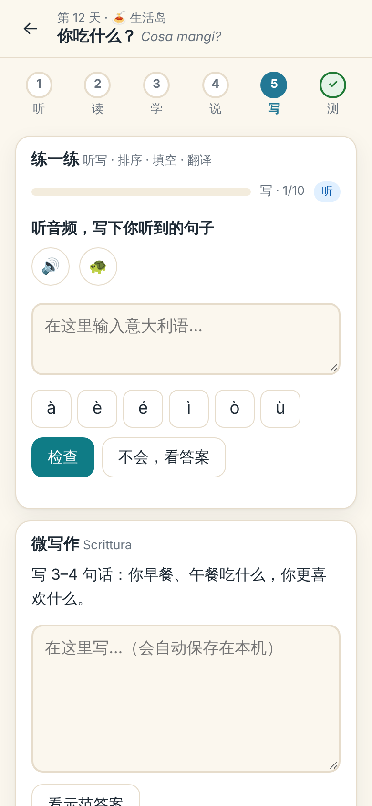
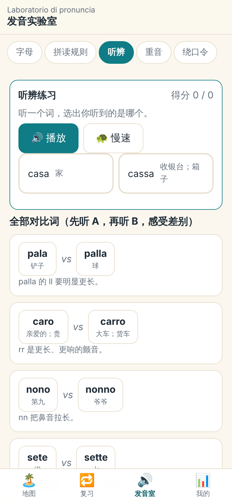

# 意大利语能力岛 · Isola

**从零开始，90 天，听说读写同步推进的意大利语学习程序。**
参考新概念英语类程序的"课文为中心、逐句点读、中英对照、跟读、听写"，并把它做成一张可闯关的岛屿地图。

<p>
  
  
  
  
</p>

- **90 天 · 3 个阶段 · 9 座岛**：前 30 天打通发音、掌握日常与差旅口语（咖啡吧、餐厅、问路、车站、机场、酒店、药店……）；第 31–60 天建立语法骨架；第 61–90 天学叙事、观点、阅读写作与实战。完整大纲见 [docs/COURSE_DESIGN.md](docs/COURSE_DESIGN.md)。
- **每天 6 步**：听（盲听）→ 读（逐句点读、中意对照）→ 学（发音 / 语法 / 文化）→ 说（跟读录音、角色扮演）→ 写（听写 / 排序 / 填空 / 翻译 / 微写作）→ 测（1–3 星，解锁下一天）。
- **练习自动生成**：从当天的对话和词汇生成听选、听写、排序、填空、中译意、配对等题型，每次都不一样。
- **间隔复习**：词汇和关键句自动进入莱特纳盒子；还有错题重练。
- **发音实验室**：字母与读音规则、最小对立词听辨（pala / palla）、重音、绕口令。
- **纯静态、无需安装、无需联网**：双击 `index.html` 就能用；进度保存在浏览器本地，可导出 / 导入。

## 内容规模

| 项目 | 数量 |
| --- | --- |
| 课程天数 | 90（含 9 个岛屿关卡、3 次阶段毕业考） |
| 对话 | 666 句（约 4,800 词） |
| 阅读短文 | 53 篇，含 124 道阅读理解题 |
| 词汇 / 词块 | 1,310 条（跨天重复的合并后得到 1,262 张词汇卡；另有 179 张关键句卡，共 1,441 张复习卡） |
| 听力理解题 / 知识小测 | 270 道 / 368 道（另有每日自动生成的小测） |
| 意大利语音频 | 3,191 条（Piper 合成，共约 31 MB，离线可用） |

## 快速开始

```bash
# 方式 1：直接双击 index.html
# 方式 2：起一个静态服务器（推荐，录音功能需要 localhost 或 https）
python3 -m http.server 8080
# 打开 http://localhost:8080
```

部署到 GitHub Pages：仓库 Settings → Pages → 选择分支根目录即可（无需构建）。

## 声音从哪来

1. **优先播放 `audio/` 里的预生成 MP3**（Piper `it_IT-paola-medium`，训练数据 CC0；48 kbps 单声道，响度已统一，峰值留有余量不削波）。
2. 没有对应文件时，回退到**浏览器自带的意大利语语音**（Web Speech API）。部分国产安卓设备没有意大利语语音，所以仓库自带了音频。
3. **录音**用 MediaRecorder（需要 localhost / https / 本地文件）；**语音识别**依赖浏览器联网服务，国内常不可用，程序会自动退回"录音对比 + 自评"。

> 合成语音不等于真人发音。重音和语调仍建议多听真人材料校正；大舌音 r 的颤动也不如真人明显，请以真人示范为准。

重新生成音频（修改课程文本之后）：

```bash
pip install piper-tts onnx                 # 并下载 it_IT-paola-medium.onnx（见 tools/gen_audio.py 开头）
node tools/export_course.js build/course.json
python3 tools/gen_audio.py --model /path/to/it_IT-paola-medium.onnx   # 可断点续跑，只生成新增文本
python3 tools/refine_pairs.py --model /path/to/it_IT-paola-medium.onnx  # 发音室对比词：逐条验证并择优重录
```

`refine_pairs.py` 的作用：合成语音每次都有随机性，pala / palla 这类"单辅音 vs 双辅音"的词对，个别词对单次采样时对比可能偏弱。脚本读取模型给每个音素分配的时长，为每个词对挑出双辅音约为单辅音 2–3 倍长的那一次录音。（抽查整个课程：b / d / l / m / n / p / t / v 等双辅音平均是单辅音的 1.7–2.2 倍，重读元音相应变短，整词总长相近——和真实意大利语一致。）

另外，生成时做了几处针对性修正（见 `tools/tts_text.py`）：把 espeak 读成闭口 e 的句中 `è`、`c'è`、`quant'è` 改回开口的 ɛ（否则"是"会读成"和"）；把词首的闪音 r（Roma、ristorante）换成颤音写法；所有音频按有声段响度统一，峰值留有余量。

## 开发与质检

```bash
npm test                          # 单元测试（文本比对、间隔复习、数据解析、练习生成、音频完整性）
node tools/validate.js            # 课程数据结构校验（天数、格式、答案序号、表格列数…）
node tests/e2e/flow.js            # 端到端：在无头 Chromium 里走完第 1 天的 6 个步骤、复习、发音室
node tests/e2e/all-days.js        # 遍历 90 天 × 6 步，确认没有渲染错误
# 意大利语拼写检查（Hunspell 词典 + 词频表，见 tools/qa_italian.py 开头）
python3 tools/qa_italian.py --dict /path/to/it_IT/it_IT --freq /path/to/it_50k.txt
# 音频抽查：用 Whisper 把整句"听写"回来，与原文比对（pip install faster-whisper）
python3 tools/qa_audio_asr.py --model small --sample 150 --min-words 3   # 随机抽查整句
python3 tools/qa_audio_asr.py --model small --only-normalized            # 只查数字/缩写/符号等被改写过的文本
```

端到端测试需要 `playwright`（`npm i -D playwright && npx playwright install chromium`）。

## 目录

```
index.html            页面入口
css/app.css           样式（明 / 暗主题，手机优先）
js/                   程序：italian.js / course.js / srs.js / exgen.js（纯函数，Node 与浏览器通用）
                      store.js / sound.js / ui.js / exercise-ui.js / view-*.js / app.js
data/                 课程内容：meta.js、island1–9.js（每岛 10 天）、pron.js（发音实验室）
audio/                预生成的意大利语音频 + manifest.js
docs/                 COURSE_DESIGN（课程设计）、DATA_FORMAT（数据格式）、REFERENCES（参考调研）
tools/                校验、导出、拼写质检、音频生成与质检（gen_audio / refine_pairs / qa_audio_asr）
tests/                单元测试与端到端测试
```

## 预期水平（实话实说）

按每天 50–60 分钟、认真完成每一步计：第 30 天能按拼读规则读出任何意大利语单词（口音仍需要真人反馈来校正），并在咖啡吧、餐厅、车站、酒店完成基本对话；第 60 天 A1 完整；**第 90 天约为 A2，含少量 B1 入门内容**（条件式、虚拟式入门）。这**不等于**能流利交谈——之后需要大量真实输入和真人对话。第 90 天给出了后续路线（CELI / CILS / PLIDA、可用资源与 30 天计划）。

## 许可与致谢

课程内容为原创；参考项目与第三方资源的许可、用途见 [CREDITS.md](CREDITS.md) 和 [docs/REFERENCES.md](docs/REFERENCES.md)。仓库所有者尚未选择许可证。
